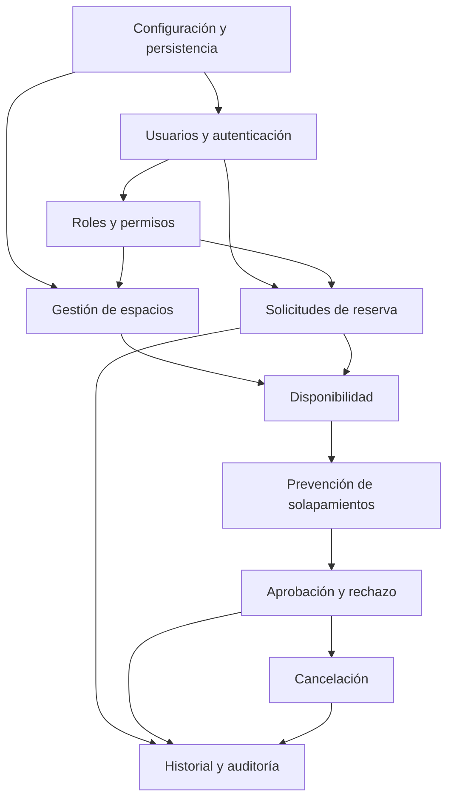

# Plan de ingeniería — Sistema de reservas de espacios académicos

## Supuestos

- La institución es una universidad con espacios compartidos por varios programas y usuarios autenticados. No se dispone todavía de políticas institucionales formales ni de un proveedor de identidad que deban integrarse.
- La primera entrega será una API REST para un único despliegue institucional. La interfaz web, integración con calendarios, notificaciones externas y alta disponibilidad quedan fuera del alcance inicial.
- Estudiantes y docentes podrán solicitar reservas; un administrador de espacios gestionará el catálogo y la decisión de solicitudes. El administrador del sistema gestionará cuentas y roles. Esta asignación inicial de responsabilidades deberá confirmarse en las especificaciones antes de implementar.
- Para evitar aceptar solicitudes fuera de la política, el plan considera que una reserva comienza como pendiente y solo se confirma mediante aprobación. El flujo final, incluidos permisos y estados, se concretará en OpenSpec.
- Las fechas y horas se intercambiarán en formato ISO 8601. Por decisión aprobada, una solicitud puede durar hasta cuatro horas inclusive; intervalos adyacentes de la misma persona en el mismo espacio se acumulan si están `PENDIENTE` o `APROBADA`. Cuentas con rol administrativo están excluidas. La zona horaria institucional, anticipación permitida, horarios hábiles y otras reglas de cancelación aún no están definidos; no se fijan valores sin aprobación.
- SQLite se usará en desarrollo y pruebas. La solución no dependerá deliberadamente de características exclusivas de SQLite y mantendrá una vía de migración a PostgreSQL.
- Supuesto de concurrencia: el mecanismo que valida y crea una reserva deberá ejecutarse dentro de una transacción que serialice escrituras relevantes; el mecanismo concreto se decidirá y probará para SQLite y se revisará para PostgreSQL antes de producción multiinstancia.

## 1. Análisis del problema

### Identificación de la problemática

Las solicitudes gestionadas por correo y hojas de cálculo no cuentan con una fuente central de disponibilidad ni con una operación atómica para registrar una reserva. Dos personas pueden solicitar el mismo espacio y franja sin detectar el conflicto. La dispersión también dificulta conocer el estado de cada petición, aplicar permisos uniformes, reconstruir quién aprobó o canceló una reserva y consultar el historial.

El problema central es de coordinación y consistencia de datos: el sistema debe ofrecer una vista fiable del catálogo, registrar las solicitudes con sus responsables y tiempos, y prevenir que dos reservas incompatibles queden aprobadas para el mismo espacio.

### Necesidades de la institución

- Consultar espacios y su disponibilidad en un intervalo determinado desde una fuente central.
- Crear, consultar y administrar solicitudes con estados explícitos.
- Validar datos, fechas, estado del espacio, autorización y conflictos antes de aceptar una solicitud o aprobarla.
- Conservar historial de cambios relevantes para auditoría operativa.
- Administrar usuarios y permisos según responsabilidades institucionales.
- Probar las reglas críticas y poder instalar el sistema en un entorno local reproducible.

### Actores involucrados

| Actor | Responsabilidades previstas |
|---|---|
| Estudiante | Consultar disponibilidad, solicitar espacios y consultar/cancelar sus solicitudes conforme a la política aprobada. |
| Docente | Consultar disponibilidad, solicitar espacios y consultar/cancelar sus solicitudes conforme a la política aprobada. |
| Administrador de espacios | Mantener los espacios que tiene asignados, revisar solicitudes y aprobarlas o rechazarlas según las reglas institucionales. |
| Administrador del sistema | Administrar cuentas y asignaciones de roles; mantener la configuración técnica del servicio. No se presume que pueda aprobar reservas salvo que la matriz de permisos lo autorice. |
| Cliente API / equipo de desarrollo | Integrar o probar la API; no obtiene permisos institucionales por el hecho de invocarla. |

La separación entre administrador de espacios y administrador del sistema evita conceder privilegios de negocio por privilegio técnico. La matriz definitiva será verificable en la especificación de roles y permisos.

### Alcance (incluido / excluido) y limitaciones del sistema

**Incluido en el producto inicial:** API REST; autenticación; usuarios y roles; CRUD de espacios; solicitudes de reserva; consulta y validación de disponibilidad; prevención de solapamientos; aprobación, rechazo y cancelación; historial/auditoría; pruebas automatizadas; documentación de instalación y operación local.

**Excluido de la primera entrega:** interfaz gráfica completa; sincronización con calendarios; correo, SMS o notificaciones push; pagos; reservas recurrentes; integración SSO/directorio institucional; aplicación móvil; despliegue productivo, alta disponibilidad y operación de infraestructura. Se podrán proponer como cambios futuros, no se asumirán como requisitos.

**Limitaciones:** SQLite es apropiado para desarrollo y pruebas y para una instancia de baja concurrencia; su bloqueo de escritura limita el escalado concurrente. La primera versión no sustituye las políticas institucionales que aún deben definirse (zona horaria, plazos, capacidad, horarios, retención de auditoría y excepciones). Las restricciones legales y de privacidad aplicables deben ser verificadas por la institución antes de producción.

## 2. Propuesta de solución

### Descripción general

Construir un monolito modular que exponga una API REST. La API valida entrada y autenticación; la capa de servicios aplica las reglas y coordina transacciones; los repositorios encapsulan el acceso a datos. Una base relacional almacena usuarios, roles, espacios, reservas y eventos de auditoría. La API permitirá consultar disponibilidad y seguir una solicitud desde su creación hasta su estado final.

Una solicitud pendiente no bloqueará por sí sola una franja salvo que la política aprobada diga lo contrario. La aprobación volverá a validar el conflicto dentro de la misma operación transaccional que cambia el estado. Esta decisión provisional reduce bloqueos por solicitudes no aprobadas; se confirmará en las specs.

### Funcionalidades prioritarias (MoSCoW)

| Prioridad | Funcionalidad | Motivo |
|---|---|---|
| Must | Usuarios, autenticación segura y autorización RBAC | Protege acciones y datos según el actor. |
| Must | Catálogo y CRUD de espacios con estado activo/inactivo | Provee la entidad cuya disponibilidad se administra. |
| Must | Crear solicitudes con validación de datos y fechas | Centraliza el proceso de solicitud. |
| Must | Limitar a cuatro horas consecutivas la ocupación por persona y espacio | Evita superar la duración institucional mediante una solicitud larga o varias solicitudes adyacentes. |
| Must | Consultar disponibilidad y evitar reservas aprobadas solapadas | Resuelve el conflicto operativo principal. |
| Must | Aprobar/rechazar con actor, fecha y motivo de rechazo | Da trazabilidad a la decisión. |
| Must | Cancelar según permisos/estado y consultar historial | Permite administrar el ciclo y auditarlo. |
| Should | Documentación OpenAPI y ejemplos reproducibles | Facilita la integración y revisión académica. |
| Should | Cobertura de errores de autorización y concurrencia | Reduce el riesgo de fallos en reglas críticas. |
| Could | Interfaz web mínima | Mejora la demostración, pero no es necesaria para validar la API. |
| Could | Notificaciones y exportación de calendario | Complementan la operación; requieren políticas e integraciones aún no definidas. |
| Won't (inicial) | Microservicios, pagos, recurrencias y SSO | Aumentan alcance y operación sin ser necesarios para el problema mínimo. |

### Organización en módulos

- **Espacios:** tipo, capacidad, ubicación y estado; control de quién administra cada espacio.
- **Usuarios:** registro o alta administrativa, autenticación, estado y datos mínimos de identidad.
- **Roles/permisos:** roles institucionales y autorización centralizada para cada acción.
- **Reservas:** solicitudes, intervalos, solicitante, estado y transiciones permitidas.
- **Disponibilidad:** consulta por intervalo y reglas de inclusión/exclusión de estados.
- **Aprobaciones:** aprobación/rechazo, decisor, marca temporal y motivo obligatorio al rechazar.
- **Historial:** eventos de creación, transición, cancelación y cambios administrativos con actor y fecha.

Los módulos serán paquetes lógicos dentro del mismo proceso, no servicios desplegables separados. Los servicios expresarán los casos de uso; los repositorios no decidirán reglas de negocio.

### Estrategia de desarrollo progresivo (incrementos)

1. **Fundación:** estructura, configuración, base relacional, esquema y convenciones de API.
2. **Identidad y acceso:** usuarios, hash de contraseñas, autenticación y RBAC.
3. **Catálogo:** espacios y permisos de administración.
4. **Solicitud y disponibilidad:** creación, lectura, consulta de disponibilidad y validaciones.
5. **Consistencia y decisión:** prevención de solapamientos bajo concurrencia, aprobación y rechazo.
6. **Ciclo y evidencia:** cancelación, historial, trazabilidad, documentación y cierre.

Cada incremento se deriva de requisitos aprobados en OpenSpec, desarrolla pruebas de aceptación/reglas antes o junto al código y termina con revisión, pruebas, tareas actualizadas y commit independiente. No se iniciará implementación antes de aprobar la revisión de specs.

## 3. Decisiones de arquitectura y tecnología

### Arquitectura seleccionada y justificación

Se propone un **monolito modular en capas**: routers HTTP/API → servicios de aplicación y dominio → repositorios/ORM → base de datos. Los esquemas Pydantic separan los contratos de entrada/salida del modelo persistente. La autorización se aplica en los límites de API y servicios para que una llamada interna no evada las reglas. La configuración se inyecta para facilitar pruebas con una base aislada.

Esta arquitectura mantiene bajo el coste de despliegue de un proyecto académico y hace explícitos los límites entre transporte, reglas y persistencia. Permite extraer componentes en el futuro si hay una necesidad demostrada; no se anticipa operación distribuida.

### Stack tecnológico

| Área | Propuesta | Justificación |
|---|---|---|
| Lenguaje/runtime | Python 3 | Sintaxis accesible, ecosistema maduro y disponibilidad de herramientas de prueba. |
| API | FastAPI | API REST tipada, validación integrada y generación de OpenAPI con poca infraestructura adicional. |
| Persistencia/ORM | SQLAlchemy 2 | Abstracción relacional portable, consultas explícitas y transacciones. |
| Validación | Pydantic | Contratos de API tipados y validación de datos. |
| Base local | SQLite | Instalación simple sin servicio externo para desarrollo y pruebas. |
| Base objetivo portable | PostgreSQL | Motor relacional adecuado para concurrencia y despliegue multiusuario; migración no incluida hasta que se apruebe como objetivo. |
| Autenticación | JWT; hash Argon2 o bcrypt | Token adecuado para API y almacenamiento no reversible de contraseñas; parámetros y biblioteca exactos se elegirán al implementar, con dependencias mantenidas. |
| Pruebas | pytest, pytest-cov, httpx2/TestClient | Pruebas unitarias e integración HTTP; cobertura reportable. Starlette recomienda actualmente httpx2 para TestClient. |
| Migraciones/esquema | Creación controlada de esquema para el prototipo; Alembic si la evolución del modelo lo requiere | Mantiene simple la primera ejecución, reservando migraciones versionadas para cambios de esquema. Esta elección se confirmará antes de persistencia. |

Las versiones concretas se fijarán en archivos de dependencias al iniciar implementación, no en este plan, para poder seleccionar versiones compatibles y mantenidas en ese momento.

### Estrategia de persistencia

Se usará un modelo relacional con claves foráneas, restricciones simples (unicidad, campos requeridos, checks cuando sean portables) e índices para consultas por espacio, estado e intervalo.

| Entidad preliminar | Datos y relaciones principales |
|---|---|
| User | Identificador, identidad institucional mínima, hash de contraseña, estado. Puede tener varios roles. |
| Role / Permission | Roles y permisos del sistema; relación muchos-a-muchos entre roles, permisos y usuarios mediante tablas asociativas. |
| Space | Identificador, nombre/código, tipo, capacidad, ubicación, estado activo/inactivo. Tiene muchas reservas. |
| Reservation | Espacio, solicitante, inicio/fin, estado, creación y versión/fechas de transición. Pertenece a un usuario y un espacio. |
| ReservationEvent | Reserva, actor, tipo de evento, fecha/hora y motivo/detalle pertinente. Permite historial append-only de decisiones y cancelaciones. |

**Prevención de solapamientos:** se adoptará el intervalo semiabierto `[inicio, fin)`, de modo que una reserva que termina a las 10:00 y otra que empieza a las 10:00 sean adyacentes y compatibles. Hay conflicto para el mismo espacio cuando `nuevo_inicio < existente_fin AND existente_inicio < nuevo_fin` y la reserva existente bloquea disponibilidad. La consulta y la transición a aprobada/creación bloqueante deben ocurrir en una transacción; la validación nunca se separará de la escritura. Para SQLite se deberá serializar la sección de escritura (por ejemplo, adquirir bloqueo de escritura antes de consultar y crear, si el driver/ORM permite garantizarlo) y probar solicitudes simultáneas. Para PostgreSQL se evaluará aislamiento/locking transaccional o una restricción de exclusión por rango como defensa adicional. Una consulta previa desde el cliente no es suficiente para prevenir carreras. La solución elegida y sus límites deberán documentarse y probarse en la fase de implementación.

**Límite de duración aprobado:** cada solicitud puede abarcar cuatro horas exactas, pero no más. Las solicitudes `PENDIENTE` y reservas `APROBADA` contiguas de la misma persona y el mismo espacio forman una secuencia cuyo tiempo total no puede superar cuatro horas; espacios distintos y personas distintas se evalúan por separado. Las solicitudes `RECHAZADA` y `CANCELADA` no consumen el límite. Cuentas con `ADMIN_ESPACIOS` o `ADMIN_SISTEMA` están excluidas, incluso si también tienen un rol solicitante. La comprobación debe realizarse en la misma sección transaccional que inserta la solicitud para evitar que peticiones simultáneas eludan la regla.

### Organización de componentes (estructura de carpetas)

Propuesta inicial, ajustable durante el bootstrap solo con justificación documentada:

```text
app/
  main.py                 # creación de FastAPI y registro de routers
  core/                   # configuración, seguridad y errores comunes
  db/                     # motor, sesión y base del mapeo ORM
  users/                  # modelos, schemas, repositorios, servicios y router
  roles/                  # permisos, modelos y autorización
  spaces/                 # modelos, schemas, repositorios, servicios y router
  reservations/           # solicitudes, estados y reglas transaccionales
  availability/           # consulta de disponibilidad
  audit/                  # eventos e historial
tests/
  unit/
  integration/
  rules/
docs/
```

La agrupación por módulo mantiene juntos los artefactos de una capacidad; `core` contiene solo infraestructura transversal. Las dependencias deben apuntar hacia servicios/dominio y persistencia, no desde módulos de negocio hacia routers.

### Tabla comparativa de decisiones técnicas

| Decisión | Selección y motivo | Alternativas descartadas y motivo |
|---|---|---|
| Estilo de arquitectura | Monolito modular en capas: un despliegue sencillo con límites internos claros para el tamaño inicial. | Microservicios: despliegue, observabilidad y consistencia distribuida añaden coste sin requisito de escala independiente. Arquitectura de un único módulo: facilita empezar, pero mezcla reglas y transporte y reduce testabilidad. |
| Persistencia | Relacional, SQLite local y diseño portable a PostgreSQL: reservas, espacios, usuarios y eventos tienen relaciones e invariantes transaccionales. | NoSQL documental: flexibilidad de esquema no aporta ventaja suficiente y complica relaciones e integridad. Solo PostgreSQL desde el inicio: viable, pero exige servicio/configuración adicional en desarrollo; se puede adoptar cuando se defina el entorno institucional. |
| Framework API | FastAPI: tipado, validación y OpenAPI integrados con Python. | Django/DRF: incluye administración y convenciones útiles, pero su estructura más amplia no se necesita para una API pequeña. Express: requiere cambiar a JavaScript/TypeScript y seleccionar más componentes para validación/persistencia; no mejora el ajuste al stack base propuesto. |
| Autenticación API | JWT de corta duración más contraseñas con hash fuerte: se ajusta a consumidores REST y permite autorización explícita por rol. | Sesiones con cookies: buena opción para una aplicación web del mismo origen, pero añade gestión de sesión/CSRF que no se necesita en la API inicial. OAuth/SSO institucional: opción preferible si existe IdP, pero integración y proveedor no están especificados. |
| Pruebas HTTP | pytest + httpx2/TestClient y SQLite aislada: permite validar contratos y flujo API sin servidor externo; httpx2 evita usar la integración httpx que Starlette actual depreca. | Pruebas manuales únicamente: no son repetibles para regresión. Framework de pruebas distinto: no ofrece beneficio claro frente al ecosistema pytest del stack base. |

## 4. Estrategia de desarrollo

### Metodología de trabajo

Trabajo iterativo e incremental guiado por SDD: plan → propuesta y specs OpenSpec → revisión y aprobación de specs → implementación trazable → cambios de reglas mediante nuevo change → cierre. Las specs aprobadas son fuente de verdad para comportamiento. Las tareas pequeñas se mantienen en `tasks.md`; un tablero (GitHub Projects o lista equivalente en el repositorio) reflejará pendiente, en curso, revisión y terminado, sin depender de un servicio externo.

Se usarán commits pequeños Conventional Commits (`docs:`, `spec:`, `test:`, `feat:`, `fix:`, `chore:`), separados por unidad lógica y en el orden exigido por la actividad. Cada commit se revisa con diff y relación a requisitos. El responsable técnico es el estudiante; la IA puede proponer y ejecutar cambios autorizados, pero no aprueba fases ni decide políticas institucionales.

### Etapas de implementación

1. Planificación y aprobación de `PLAN_INGENIERIA.md`.
2. Inicialización de OpenSpec y contexto de proyecto derivado del plan aprobado.
3. Especificación de las ocho capacidades mínimas y validación estricta.
4. Revisión cruzada de consistencia, trazabilidad y tareas; aprobación antes del código.
5. Implementación incremental siguiendo dependencias y tareas, con pruebas primero cuando sea viable.
6. Change control para la regla de cuatro horas: análisis, aprobación de decisiones, spec, aprobación, tareas, pruebas/código y archivo.
7. Verificación final, documentación, informe y revisión del historial Git.

Las puertas de aprobación son obligatorias: al presentar el plan, las specs, la revisión de specs, el cierre de implementación y la actualización de la regla, se detiene el trabajo hasta recibir aprobación expresa.

### Orden de desarrollo de funcionalidades

Fundación y persistencia → usuarios/autenticación → roles/permisos → espacios → solicitudes de reserva → disponibilidad y prevención de simultaneidad → aprobación/rechazo → cancelación/historial → documentación y cierre. La precedencia permite que cada caso de uso se apoye en sus datos y controles ya establecidos. El orden solo cambia mediante decisión documentada, con el impacto reflejado en dependencias y tareas.

### Dependencias entre componentes



La dependencia indica precedencia de datos/reglas; no implica que cada módulo se despliegue de forma independiente.

### Criterios de terminación (Definition of Done) de cada etapa

| Etapa | Criterios verificables de terminación |
|---|---|
| Plan | `PLAN_INGENIERIA.md` contiene las secciones requeridas, supuestos, decisiones justificadas, riesgos y DoD; el estudiante revisa y aprueba; commit exclusivo del plan. |
| Contexto OpenSpec | OpenSpec inicializado; `project.md` refleja el plan aprobado; instrucciones y archivos de contexto revisados; commit separado. |
| Specs iniciales | Ocho capacidades con requisitos normativos y escenarios verificables, tareas y decisiones relevantes; `openspec validate --strict` exitoso con salida registrada; commit(s) solo de specs; aprobación explícita. |
| Revisión de specs | Consistencia y ambigüedades documentadas, correspondencia con plan y tareas trazables; validación estricta exitosa; revisión y aprobación; commit separado; aún no hay código funcional. |
| Grupo de implementación | Tareas aprobadas seguidas en orden; pruebas asociadas a escenarios; suite ejecutada con salida real; trazabilidad actualizada; tareas marcadas; diff revisado y commit pequeño; aprobación para avanzar al siguiente grupo. |
| Cambio de cuatro horas | Impacto y decisiones ambiguas revisados; plan actualizado si corresponde; spec modificada antes que pruebas/código; validación estricta; aprobación en cada puerta requerida; pruebas nuevas/regresión; change archivado y trazabilidad actualizada. |
| Cierre | Suite completa con cobertura ejecutada; OpenSpec validado; matriz requisitos-specs-pruebas-código revisada; README ejecutable desde cero; informe completo; secuencia Git comprobada; commit final de documentación. |

## 5. Estrategia de calidad

### Tipos de pruebas

- **Unitarias:** validadores, reglas de intervalo, transiciones de estado y autorización aislados.
- **Integración/API:** contratos HTTP, serialización, autenticación y persistencia usando FastAPI TestClient/httpx y base de prueba independiente.
- **Reglas de negocio:** estados válidos, fechas pasadas, espacio inactivo, permisos, rechazo con motivo, cancelación y visibilidad de historial.
- **Regresión:** suite completa después de cada grupo funcional y de cada cambio aprobado.
- **Concurrencia/solapamiento:** intervalos superpuestos para un mismo espacio, intervalos adyacentes permitidos, espacios distintos, y operaciones simultáneas que intentan aprobar el mismo intervalo; verificar que no resulten dos reservas incompatibles aprobadas.
- **Seguridad:** hash no reversible, autenticación con credenciales inválidas, tokens ausentes/expirados y acceso denegado según rol.

Los casos y el resultado observado se vincularán a escenarios; no se afirmará que una prueba pasa sin ejecutar y conservar su salida.

### Riesgos y mitigaciones

| Riesgo | Probabilidad | Impacto | Mitigación |
|---|---|---|---|
| Aceptar dos reservas solapadas por una carrera concurrente | Media | Alto | Validar dentro de transacción serializada, bloquear antes de comprobar cuando aplique y crear pruebas simultáneas; evaluar restricción de exclusión al migrar a PostgreSQL. |
| Políticas institucionales incompletas (horarios, zona, anticipación, excepciones de cancelación) | Alta | Alto | Registrar supuestos, convertir dudas en decisiones antes de implementar la regla afectada y exigir escenarios explícitos en specs. |
| Asignación excesiva o insuficiente de permisos | Media | Alto | Matriz rol-acción aprobada, pruebas positivas y negativas por rol, autorización en servicios además de endpoints sensibles. |
| Fechas ambiguas por zona horaria o conversión | Media | Alto | ISO 8601 con zona, normalización consistente a UTC en almacenamiento y pruebas de límites; confirmar la zona institucional antes de producción. |
| SQLite no representa fielmente el comportamiento concurrente de producción | Media | Alto | Probar el mecanismo local, documentar límite de instancia única y verificar transacciones/índices con PostgreSQL antes de un despliegue multiinstancia. |
| Pérdida o alteración de evidencia de auditoría | Baja | Alto | Eventos append-only desde servicios, pruebas de transiciones auditadas y política de respaldo/retención antes de producción. |
| Dependencias o configuración inseguras | Media | Medio | Versiones fijadas, secretos por variables de entorno fuera de Git, hash fuerte de contraseña y revisión de dependencias al preparar la entrega. |

### Mecanismos para verificar cumplimiento de requisitos

- Mantener `docs/TRAZABILIDAD.md` con columnas **requisito → escenario OpenSpec → prueba → archivo de código → evidencia/estado**. No marcar como implementado algo sin prueba y ruta verificable.
- Usar identificadores estables de requisitos/escenarios en specs y referenciarlos en nombres o comentarios de pruebas y tareas.
- Ejecutar `openspec validate --strict` al cerrar specs y cualquier change relevante; conservar comando y resultado en la revisión/cierre.
- Ejecutar `pytest` y `pytest-cov` por incremento y al cierre; configurar cobertura mínima inicial de 80% de líneas en código de negocio, excluyendo configuración/migraciones solo con justificación. Umbral revisable si la herramienta o el alcance lo requiere y se documenta antes de reducirlo.
- Revisar casos negativos y bordes además del camino feliz: intervalos, estados, permisos, fechas, espacios inactivos y reintentos concurrentes.
- Revisar manualmente cada diff y comparar contra tareas aprobadas; cualquier requerimiento ausente se resuelve mediante OpenSpec antes de código adicional.

## 6. Uso de SDD e inteligencia artificial

### Cómo se usará OpenSpec (ciclo proposal → apply → archive, specs como fuente de verdad)

OpenSpec expresará el comportamiento por capacidad y los cambios en propuestas revisables. El flujo será `proposal` para acordar propósito, alcance y decisiones; `apply` para convertir tareas aprobadas en pruebas y código; `archive` al completar el change para consolidar specs. Las specs aprobadas describen el comportamiento normativo; el plan explica la estrategia y no sustituye los requisitos detallados. Se ejecutará `openspec validate --strict` al revisar cada conjunto. No se implementará una capacidad antes de aprobar sus specs.

### Cómo se transformará el plan en especificaciones

Las ocho capacidades del alcance (espacios, usuarios, roles/permisos, solicitudes, disponibilidad, prevención de simultaneidad, aprobación/rechazo y cancelación/historial) se convertirán en capabilities/changes OpenSpec. Cada requisito deberá formular una obligación con **DEBE/SHALL**, restricciones, casos límite y escenarios de aceptación `#### Scenario:` con `WHEN`/`THEN` (y contexto cuando sea útil). La revisión verificará nombres, estados, roles e invariantes compartidos y mapeará cada capability a las secciones del plan. Las políticas no definidas permanecerán como dudas o supuestos, no como decisiones silenciosas.

### Qué actividades se delegan a la IA y cuáles no

**Delegables con revisión:** proponer redacción y estructura de plan/specs, generar escenarios a partir de decisiones aprobadas, sugerir tareas ordenadas, crear pruebas derivadas de escenarios, implementar tareas aprobadas, mantener trazabilidad y README, ejecutar herramientas y reportar salidas literales, detectar inconsistencias y preparar borradores de informe.

**No delegables como decisión final:** aprobación de fases y cambios; interpretación de políticas institucionales ambiguas; aceptación del modelo de permisos y excepciones; evaluación de riesgos institucionales; validación del resultado como responsable técnico; entrega o publicación con credenciales personales. La IA no debe inventar resultados de pruebas ni afirmar cumplimiento sin evidencia.

### Cómo se verificará el código generado

Cada cambio se cotejará con tarea, requisito y escenario aprobados. Se escribirán pruebas para los escenarios antes o junto a la implementación; se ejecutarán las pruebas pertinentes y la suite completa en los hitos requeridos. Se inspeccionará el diff para confirmar límites de arquitectura, ausencia de reglas no especificadas, manejo de errores, seguridad y trazabilidad. Los comandos y salidas reales se registrarán en el resumen de fase/entrega. Si una necesidad nueva no está especificada, se propondrá un change en vez de improvisar código.

### Decisiones que son responsabilidad exclusiva del estudiante

El estudiante, como responsable técnico, aprueba este plan y cada puerta de fase; define o confirma las políticas de la universidad (roles, permisos, duración/horarios, zona horaria, cancelación y retención); acepta cambios de stack y de arquitectura; resuelve dudas de negocio; evalúa las decisiones técnicas; decide qué se publica y presenta; personaliza el informe y las respuestas de sustentación según su experiencia real. La aprobación se expresará de forma explícita en la conversación y no se inferirá de que el trabajo parezca completo.

## Historial de versiones del plan

| Versión | Fecha | Cambio |
|---|---|---|
| 0.1 | 2026-10-21 | Borrador inicial para revisión del responsable técnico. Stack y alcance propuestos según las instrucciones de la actividad; políticas no definidas registradas como supuestos. |
| 0.2 | 2026-10-22 | Se ajusta el cliente de pruebas de `httpx` a `httpx2` conservando `TestClient`, porque Starlette actual depreca la integración anterior y recomienda `httpx2`. El cambio afecta solo dependencias de desarrollo y mantiene el diseño de pruebas HTTP aprobado. |
| 0.3 | 2026-10-22 | Se incorpora la regla institucional aprobada de máximo cuatro horas consecutivas por persona y espacio: cuatro horas inclusive, acumulación de solicitudes pendientes/aprobadas contiguas, y exclusión de cuentas administradoras. La regla afecta las validaciones de solicitudes y su estrategia de concurrencia; no requiere migración de datos. |
